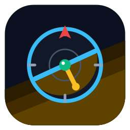
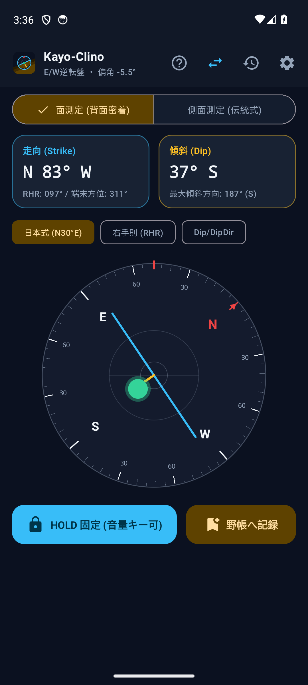
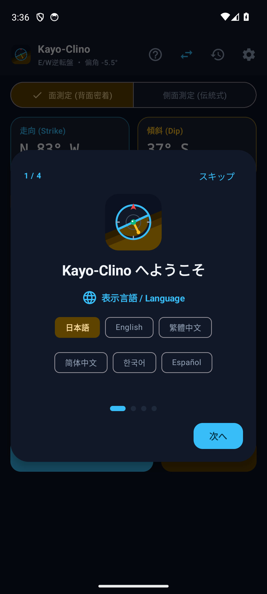
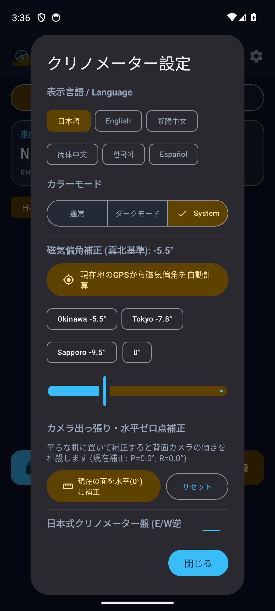

#  Kayo-Clino — 地学クリノメーター (Geological Clinometer for Android)

[](https://github.com/JustCat3456/Kayo-Clino/releases/latest)
[-3DDC84?logo=android&logoColor=white)](#)
[](#)
[](#)
[](LICENSE)

**`Kayo-Clino`（カヨウ・クリノ）** は、沖縄本島北部・名護市東海岸に分布し、日本屈指のタービダイト砂岩泥岩互層と褶曲構造で知られる国指定天然記念物 **「嘉陽層の褶曲（Kayo Formation）」** から名付けられた、野外地質調査（巡検・ルートマップ作成・構造地質解析）向けの **Material 3 デジタルクリノメーター** です。

地層面や断層面の **走向（Strike）** と **傾斜（Dip）** を迅速・正確・片手で測定できるよう、複雑な下タブや多階層メニューを排除し、**「露頭の前で取り出して1秒で測れるシンプルな道具」** としての使い勝手を追求しています。

---

## 📥 ダウンロード / インストール (Download)

<p align="left">
  <a href="https://github.com/JustCat3456/Kayo-Clino/releases/latest">
    
  </a>
  &nbsp;
  <a href="https://apps.obtainium.imranr.dev/redirect?r=obtainium://add/https://github.com/JustCat3456/Kayo-Clino">
    
  </a>
  &nbsp;
  <a href="https://www.komistore.app">
    
  </a>
</p>

- **GitHub Releases**: [最新リリースページ](https://github.com/JustCat3456/Kayo-Clino/releases/latest) から署名済み APK（`kayo-clino-v1.x.x.apk`）を直接ダウンロードしてインストールできます。
- **Obtainium**: 端末に [Obtainium](https://github.com/ImranR98/Obtainium) が入っている場合、上の **Download from Obtainium** バッジをタップするだけで自動更新対象としてワンタップ登録できます。
- **Komi Store**: OSS アプリストア [Komi Store](https://www.komistore.app) 内で `JustCat3456/Kayo-Clino` を検索してインストール・自動更新できます。

---

## 📸 スクリーンショット

| ① メイン計測画面 (面測定・HOLD) | ② 初回オンボーディング (4ステップ) | ③ 設定 (カラーモード・ゼロ点補正) |
| :---: | :---: | :---: |
|  |  |  |
| **走向線(水色)・最大傾斜線(黄)** と<br>気泡水準器をリアルタイム描画 | 全スライド共通のカードサイズで<br>言語・測定モード・音声・偏角を設定 | カラーモード(ライト/ダーク/自動)・<br>カメラ出っ張り補正・デバッグ階層メニュー |

---

## ✨ 主な特徴・使い勝手へのこだわり

### 1. 2つの測定モード（ワンタップ切替）
- **面測定モード（背面密着 / Planar Mode）**:
  スマートフォンの背面を層理面・節理面にピタッと当てるだけで、3次元法線ベクトルから **走向（Strike）** と **最大傾斜角（Dip）・傾斜方位（Dip Direction）** を同時に算出します（オーバーハング面で画面が下を向く姿勢でも自動判定）。
- **側面測定モード（伝統式 / Classic Edge Mode）**:
  従来のアナログクリノメーターと同様に、端末の長辺を地層面に当てて走向・傾斜角を測定します。

### 2. 日本式クリノコンパス盤（E/W 逆転表示）＆ 3種の表記フォーマット
- **E/W 逆転コンパス盤**:
  日本の地学調査で使われる伝統的なクリノメーターと同様、盤面の東（E）と西（W）を逆転配置し、磁針から走向を直読できるモードを標準搭載（上部バーの `E⇄W` ボタンでいつでも標準コンパス盤と切替可能）。
- **表記フォーマットのリアルタイム切替**:
  - **日本式（象限表記）**: `N 35° E  /  42° SE`
  - **右手則（Right-Hand Rule）**: `035° / 42° SE`
  - **Dip / Dip-Direction 式**: `125° (SE) / 42°`

### 3. 画面が見えない露頭での「音量ボタン HOLD」＆「音声読み上げ (TTS)」
- 頭上のオーバーハング面や狭い岩陰など、画面を覗き込めない角度でスマホを当てているときでも、**端末側面の音量キー（＋ / ー）を押すだけでバイブレーションとともに計測値を HOLD（固定）** できます。
- **音声読み上げ機能** を ON にすれば、HOLD した瞬間に *「走向 北35度東、傾斜 42度南東」*（英語モード時は *"Strike North 35 degrees East, Dip 42 degrees SE"*）と音声で知らせます。

### 4. GPS による現在地の磁気偏角（WMM）自動計算
- Android 標準の `GeomagneticField`（世界磁気モデル WMM）と GPS 測位を組み合わせ、現在地の緯度・経度・高度から **真北基準の磁気偏角（例: 沖縄 `-5.5°`、東京 `-7.8°`、札幌 `-9.5°`）をワンタップで自動算出** します（通信圏外の山間部でも GPS 電波のみで計算可能）。

### 5. 背面カメラ出っ張り「水平ゼロ点補正（キャリブレーション）」
- 近年のスマートフォンが持つ「背面カメラレンズの出っ張り（バンプ）」によるわずかな傾き（1°〜3°）を、平らな机の上でワンタップ補正して正確な `0° (水平)` を出せるゼロ点補正機能を備えています。

### 6. 初回オンボーディング・カルーセル ＆ 6言語・3カラーモード対応
- 初回起動時にのみ、カードサイズを全スライドで統一したシンプルな 4 ページのカルーセルで初期設定（言語選択、面測定・側面測定の確認、音量キーHOLD・音声読み上げ、GPS磁気偏角）を案内します（設定画面の「デバッグ」メニューからいつでも再表示可能）。
- アプリ内で **日本語 (`ja`)・英語 (`en`)・繁体字中国語 (`zh-TW`)・簡体字中国語 (`zh-CN`)・韓国語 (`ko`)・スペイン語 (`es`)** の 6 言語、および **ライト・ダーク・自動** の 3 カラーモードを即座に切り替えられます。

### 7. ローカル永続化された「デジタル野帳」＆ CSV エクスポート
- 露頭番号・岩相メモ・GPS座標・日時とともに保存した計測記録や各種設定はすべて端末内に永続保存され、ワンタップで **QGIS や Excel にそのまま貼り付けられる CSV 形式** でクリップボードにコピーできます。

---

## 🌍 翻訳・新しい言語の追加方法 (Contributing Translations / Pull Request)

このアプリの言語データは、Kotlin のコードに埋め込まず **`app/src/main/assets/i18n/<言語コード>.json`** のフラットな JSON ファイルとして独立管理しています。そのため、Android 開発環境がなくても **JSON ファイル 1 つを翻訳するだけで簡単に Pull Request を送ることができます**。

### 新しい言語を追加する 2 ステップ

1. [`app/src/main/assets/i18n/en.json`](app/src/main/assets/i18n/en.json)（または [`ja.json`](app/src/main/assets/i18n/ja.json)）をコピーして、新しい言語コードのファイル（例: フランス語なら `fr.json`、ドイツ語なら `de.json`）を作成し、値を翻訳します。
   - 万が一未翻訳のキーがあっても、実行時に自動で `en.json` にフォールバックするためクラッシュしません。
   - `%d` や `%.1f` などのフォーマット指定子はそのまま維持してください。
2. [`ClinometerData.kt`](app/src/main/java/com/example/clinometer/model/ClinometerData.kt) の `AppLanguage` Enum に 1 行追加します：
   ```kotlin
   enum class AppLanguage(val code: String, val nativeName: String, val localeTag: String) {
     JA("ja", "日本語", "ja-JP"),
     EN("en", "English", "en-US"),
     ZH_TW("zh-TW", "繁體中文", "zh-TW"),
     ZH_CN("zh-CN", "简体中文", "zh-CN"),
     KO("ko", "한국어", "ko-KR"),
     ES("es", "Español", "es-ES"),
     FR("fr", "Français", "fr-FR") // ← 1行追加するだけで設定画面・初回カルーセル・音声読み上げに自動反映！
   }
   ```
3. `./gradlew testDebugUnitTest` を実行すると、`i18nJsonFiles_existForAllLanguagesAndContainAllBaseKeys` テストが全言語ファイルのキー漏れを自動チェックします。

---

## 📐 センサー幾何アルゴリズム

`Sensor.TYPE_ROTATION_VECTOR` から取得した 3×3 回転行列 $R$（デバイス座標系 $\to$ ワールド座標系 $X=\text{East}, Y=\text{North}, Z=\text{Up}$）に対し、カメラ出っ張りオフセット回転補正を適用した単位法線ベクトル $\vec{n} = (n_x, n_y, n_z)$（上向き正規化 $n_z \ge 0$）から各値を算出しています。

$$\text{Dip} = \arccos(n_z) \times \frac{180}{\pi} \in [0^\circ, 90^\circ]$$

$$\text{DipDirection} = \left(\operatorname{atan2}(n_x, n_y) \times \frac{180}{\pi} + \delta_{\text{declination}} + 360^\circ\right) \bmod 360^\circ$$

$$\text{Strike}_{\text{RHR}} = (\text{DipDirection} - 90^\circ + 360^\circ) \bmod 360^\circ$$

さらに高リフレッシュレート（120Hz 等）のディスプレイでも針や気泡が滑らかに追従するよう、$0^\circ / 360^\circ$ 境界をまたいでも最短弧で補間する三角関数ローパスフィルタ（Circular Low-Pass Filter）を適用しています。

---

## 🛠 ビルド ＆ インストール方法

### 必要環境
- **JDK**: Eclipse Adoptium OpenJDK 17 (`Temurin-17`)
- **Android SDK**: API Level 35 (`platforms;android-35`, `build-tools;35.0.0`)

### コマンドラインからのビルド・テスト

```bash
# 単体テストの実行
./gradlew testDebugUnitTest

# デバッグ APK のビルド
./gradlew assembleDebug

# USB 接続した実機へのインストール
./gradlew installDebug
```

---

## 📂 ディレクトリ構成

```text
kayo-clino/
├── app/src/main/assets/i18n/            # 6言語フラットJSON翻訳ファイル (ja/en/zh-TW/zh-CN/ko/es)
├── app/src/main/java/com/example/clinometer/
│   ├── MainActivity.kt                  # エントリポイント・音量キーHOLD・TTS音声読み上げ
│   ├── data/
│   │   └── ClinometerStorage.kt         # 設定＆デジタル野帳レコードのローカル永続化
│   ├── domain/
│   │   └── ClinometerCalculator.kt      # 走向・傾斜計算、カメラ出っ張り補正、ローパスフィルタ
│   ├── model/
│   │   └── ClinometerData.kt            # ドメインモデル・測定モード・言語定義
│   ├── sensor/
│   │   ├── ClinometerSensorManager.kt   # Rotation Vector / 加速度＋地磁気センサーFlow
│   │   └── LocationDeclinationHelper.kt # GPS測位＋世界磁気モデル(WMM)偏角自動計算
│   └── ui/
│       ├── ClinometerScreen.kt          # Material 3 メイン画面・設定・野帳シート
│       ├── ClinometerViewModel.kt       # UI状態管理
│       ├── components/
│       │   ├── ClinometerDial.kt        # コンパス盤・走向傾斜記号・気泡水準器Canvas
│       │   └── OnboardingCarouselDialog.kt # 初回起動4ステップカルーセル
│       ├── i18n/
│       │   └── AppStrings.kt            # 6言語JSONリソースローダー
│       └── theme/                       # Material 3 高視認性カラー＆テーマ定義
├── app/src/test/                        # 幾何計算・ゼロ点補正・音声フォーマットの単体テスト
├── docs/badges/                         # 配布ストア用ダウンロードバッジ (GitHub / Obtainium / Komi Store)
└── docs/screenshots/                    # README用スクリーンショット画像 (SVG / PNG)
```
